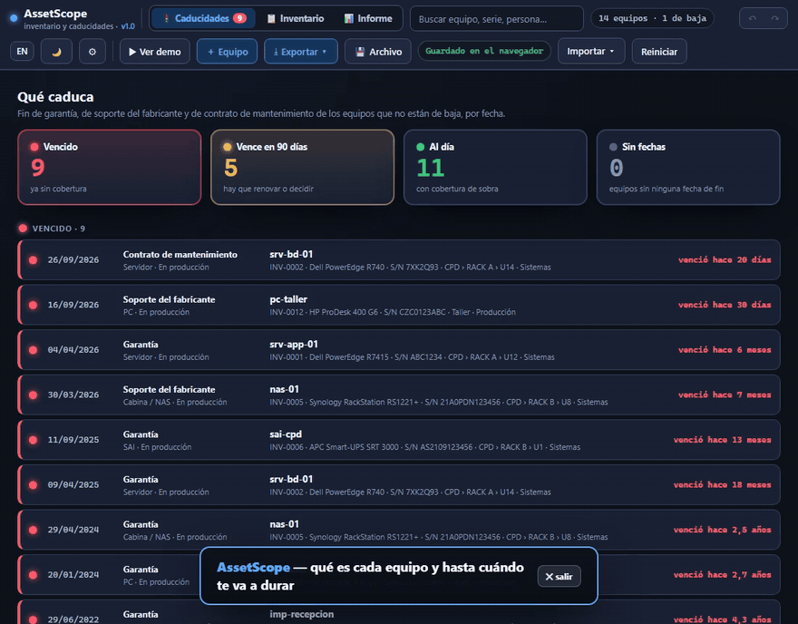

***Español** · [English](README.en.md)*

# AssetScope

**Qué es cada equipo y hasta cuándo te va a durar.** Inventario, garantías y fin de soporte en un solo archivo HTML. Sin servidor, sin instalación y sin que salga un dato de tu equipo.

[RackScope](https://github.com/marcosblg/rackscope) te dice *dónde está* cada equipo. [SubnetScope](https://github.com/marcosblg/subnetscope) te dice *qué IP tiene*. AssetScope te dice *qué es y cuándo caduca*.

Nació para sustituir la típica hoja de inventario: la que tiene veinte columnas, nadie mira y te avisa de que la garantía del servidor venció cuando ya se ha roto. Aquí, al abrir, lo primero que ves es un semáforo con lo que ya está vencido y lo que vence pronto.

### 👉 [Pruébalo ahora en el navegador](https://marcosblg.github.io/assetscope/)

🌐 **En español y en inglés**: sale en el idioma de tu navegador y se cambia con el botón **EN / ES**.

No hay que instalar ni descargar nada: el enlace abre la herramienta con un inventario de ejemplo. Pulsa **▶ Ver demo** para la visita guiada.



🎬 **[Ver el vídeo de demostración (30 s)](docs/demo.mp4)** · o pulsa **▶ Ver demo** dentro de la propia aplicación para recorrerla tú mismo.

## Qué hace

**El semáforo de caducidades**
- Al abrir no ves una tabla, ves lo que importa: 🔴 **vencido**, 🟠 **vence en 90 días** y 🟢 **al día**, ordenado por fecha.
- Cuenta tres fechas por equipo: **fin de garantía**, **fin de soporte del fabricante** y **fin del contrato de mantenimiento**.
- Los equipos sin ninguna fecha salen aparte, para que sepas qué te falta por apuntar.
- Los días de aviso se cambian en ⚙ (90 por defecto). Los equipos de baja no cuentan.

**Ficha de equipo**
- **Identidad**: nombre, tipo (servidor, switch, router, cortafuegos, cabina, SAI, AP, PC, portátil, impresora…), marca, modelo y **número de serie**.
- **Estado**: en producción, en almacén, prestado, en RMA o de baja. Cada cambio de estado queda apuntado en el historial.
- **Ubicación**: sala, rack y U si está rackeado, o texto libre ("Despacho 3").
- **Asignado a** una persona o un departamento.
- **Compra**: proveedor, fecha, nº de factura, precio y centro de coste.
- **Historial** de averías y notas con fecha.
- **Adjuntos** por ruta o enlace (la factura en `\\servidor\facturas\…`), nunca el archivo dentro de los datos.
- Avisa si repites un número de serie o de inventario.

**Inventario**
- Tabla con todos los equipos, filtros por tipo, estado y ubicación, y orden por cualquier columna.
- Buscador por nombre, número de serie, persona, sala, proveedor o factura (Ctrl+F).

**Informe de parque**
- Cuántos equipos hay y de qué tipo, valor total de compra y cuántos tienen 5 años o más.
- **Qué caduca en los próximos 12 meses y cuánto costaría renovarlo**, con el coste de renovación de cada ficha o, si no lo tiene, el precio de compra.
- Reparto por tipo, antigüedad, estado y ubicación.
- Sale en **PDF** listo para enseñar, con el inventario completo al final.

**Etiquetas con QR**
- Hoja A4 de 3 × 8 etiquetas (70 × 37 mm) con el nº de inventario, el nombre, el modelo, el número de serie y un QR.
- El QR lleva los datos del equipo y se lee con cualquier móvil sin conexión. O, si lo prefieres, un enlace que abre su ficha en AssetScope.
- El generador de QR va dentro del propio HTML: no se llama a ningún servicio de fuera.

**Avisos sin servidor**
- **Calendario de vencimientos (.ics)**: un evento por cada aviso (90, 30 y 7 días antes y el día que vence) para importar en Outlook o Google Calendar. El aviso te llega al calendario y al móvil.
- **Al abrir**, lo que ha entrado en aviso o ha vencido desde tu última visita sale arriba y marcado como NUEVO.

**Importar sin teclear**
- **Desde Excel (CSV)**: reconoce solo las columnas habituales en español o inglés (*Nº de serie*, *Serial Number*, *Fin de garantía*, *Warranty end*…), las fechas en cualquier formato y los precios con coma. Si el equipo ya existe (mismo número de serie), solo rellena lo que falta.
- **Desde RackScope**: trae los equipos de tus racks con su sala, rack y U. Los paneles de parcheo y los huecos se quedan fuera.

**Lo de siempre**
- Exportación a **CSV para Excel**, **PDF** y **JSON** (copia de seguridad).
- **Guardado en un archivo tuyo**: lo vinculas una vez y se reescribe solo cada vez que cambias algo. Puede estar en una carpeta de red.
- Deshacer y rehacer con **Ctrl+Z / Ctrl+Y**, tema claro y oscuro, y demo guiada.

## Lo que no hace (a propósito)

Ni agentes que escaneen la red, ni tickets, ni licencias de software, ni servidor. Para eso ya están GLPI y compañía. AssetScope responde a una pregunta y la responde bien: qué tienes y cuándo caduca.

## Cómo usarlo

1. Descarga `index.html` (o abre el [enlace de prueba](https://marcosblg.github.io/assetscope/)).
2. Ábrelo con doble clic en Chrome, Edge o Firefox.
3. Pulsa **Reiniciar › Empezar en blanco** y da de alta tus equipos, o tráete tu hoja con **Importar › Desde Excel**.
4. Pulsa **💾 Archivo** para que se guarde solo en un archivo tuyo.

El vínculo con el archivo funciona en Chrome y Edge. En Firefox se guarda en el navegador y puedes exportar el JSON cuando quieras.

## Formato de los datos

Un JSON legible, pensado para compartirse entre las tres herramientas. La clave que las une es el **número de serie**:

```json
{
  "v": 1,
  "app": "assetscope",
  "activos": [
    {
      "id": "a1",
      "inv": "INV-0001",
      "nombre": "srv-app-01",
      "tipo": "servidor",
      "marca": "Dell",
      "modelo": "R7415",
      "serie": "ABC1234",
      "estado": "produccion",
      "ubicacion": { "sala": "CPD", "rack": "RACK A", "u": "12" },
      "asignado": "Sistemas",
      "compra": { "proveedor": "", "fecha": "2023-04-12", "factura": "", "precio": 4200, "centroCoste": "" },
      "ciclo": { "garantia": "2027-04-12", "soporte": "2029-01-01", "mantenimiento": "", "renovacion": 0 },
      "historial": [ { "fecha": "2025-11-02", "texto": "Sustituida fuente 2" } ],
      "adjuntos": [ { "nombre": "Factura", "ruta": "\\\\nas-01\\facturas\\F-2023-0412.pdf" } ],
      "notas": ""
    }
  ]
}
```

## Privacidad

Todo funciona dentro de tu navegador. El HTML bloquea cualquier conexión a Internet (política de seguridad `connect-src 'none'`): ni analítica, ni fuentes externas, ni librerías de terceros.

## Licencia

AGPL-3.0. Puedes usarlo y modificarlo libremente, también dentro de tu empresa. Si distribuyes una versión modificada o la ofreces como servicio, tienes que publicar el código con esta misma licencia.

El nombre **AssetScope** y su identidad visual no entran en la licencia del código: si publicas un derivado, ponle otro nombre.

**¿Lo usáis en vuestra empresa?** Si necesitáis una licencia que no obligue a publicar vuestro código, o soporte, escribidme por LinkedIn: https://es.linkedin.com/in/marcos-belmonte-gomez-9b5a71205
